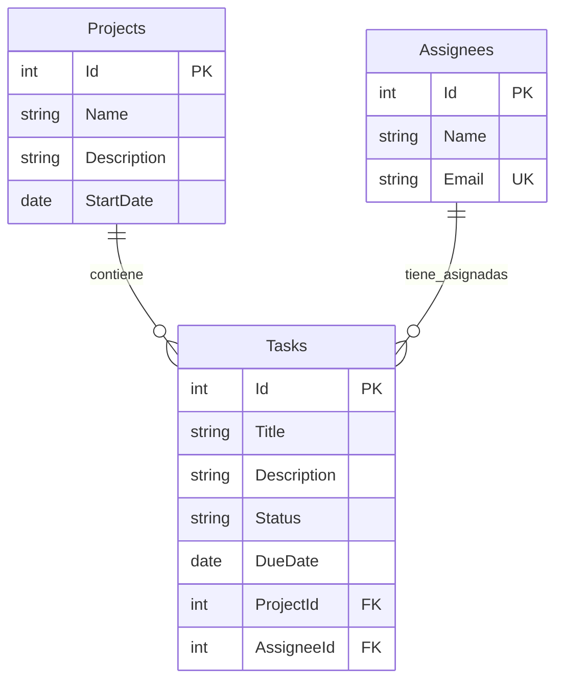

# Modelo de datos

La aplicación utiliza tres entidades principales:
Project, Assignee y TaskItem.

En SQL Server se almacenan en las tablas Projects,
Assignees y Tasks.

## Diagrama de relaciones

PK significa clave primaria.
FK significa clave foránea.
UK indica un valor único.

Description es opcional en Projects y Tasks.
Los demás campos del diagrama son obligatorios.

## Projects — Proyectos

| Campo | Tipo en SQL Server | Restricción |
|---|---|---|
| Id | int | Clave primaria autogenerada |
| Name | nvarchar(100) | Obligatorio |
| Description | nvarchar(1000) | Opcional |
| StartDate | date | Obligatorio, sin hora |

Un proyecto puede existir sin tareas o tener muchas.
Cada tarea pertenece a un único proyecto.

## Assignees — Responsables

| Campo | Tipo en SQL Server | Restricción |
|---|---|---|
| Id | int | Clave primaria autogenerada |
| Name | nvarchar(100) | Obligatorio |
| Email | nvarchar(254) | Obligatorio y único |

El correo se guarda sin espacios exteriores y en minúsculas.
La API comprueba los duplicados y SQL Server mantiene un índice
único como protección adicional.

Un responsable puede existir sin tareas o tener muchas.
Puede trabajar en tareas de distintos proyectos.

Los responsables no son cuentas de acceso a la aplicación.

## Tasks — Tareas

La clase C# se llama TaskItem para distinguirla del tipo Task
utilizado en operaciones asíncronas.

| Campo | Tipo en SQL Server | Restricción |
|---|---|---|
| Id | int | Clave primaria autogenerada |
| Title | nvarchar(150) | Obligatorio |
| Description | nvarchar(1000) | Opcional |
| Status | nvarchar(20) | Obligatorio |
| DueDate | date | Obligatorio, sin hora |
| ProjectId | int | Clave foránea obligatoria a Projects.Id |
| AssigneeId | int | Clave foránea obligatoria a Assignees.Id |

Cada tarea tiene exactamente un proyecto y un responsable.

La tabla guarda sus identificadores, no sus nombres.
La API consulta las relaciones y devuelve projectName y
assigneeName para mostrarlos en React.

## Estados de una tarea

| Valor almacenado | Texto mostrado |
|---|---|
| Pending | Pendiente |
| InProgress | En progreso |
| Completed | Completada |

Una tarea nueva empieza en Pending.
Al editar se permite cambiar entre los tres estados,
incluido reabrir una tarea completada.

La API valida los valores permitidos. El tamaño de la columna
por sí solo no limita el estado a esos tres valores.

## Protección de las relaciones

Las claves foráneas impiden guardar tareas relacionadas
con proyectos o responsables inexistentes.

El borrado está configurado con restricción, sin cascada.
SQL Server refleja esta configuración como NO_ACTION.

Para eliminar un proyecto o responsable con tareas:

1. Reasignar sus tareas o eliminarlas.
2. Eliminar después el proyecto o responsable.

Una tarea completada también impide borrar sus registros
relacionados.

La API devuelve 409 cuando detecta esa dependencia.

## Reglas de fechas

- DueDate debe ser igual o posterior a StartDate del proyecto.
- Se permiten fechas pasadas.
- Al modificar StartDate, la API comprueba que ninguna tarea
  quede con vencimiento anterior al nuevo inicio.
- Estas comparaciones se validan en el backend.
- Las fechas se almacenan sin hora y se intercambian como YYYY-MM-DD.

## Archivos relacionados

- backend/Models/Project.cs
- backend/Models/Assignee.cs
- backend/Models/TaskItem.cs
- backend/Data/ApplicationDbContext.cs
- backend/Migrations
- backend/Controllers
- backend/DTOs

ApplicationDbContext configura las entidades, el índice único
del correo y las relaciones.

Las migraciones describen los cambios necesarios para construir
y actualizar la estructura de SQL Server.