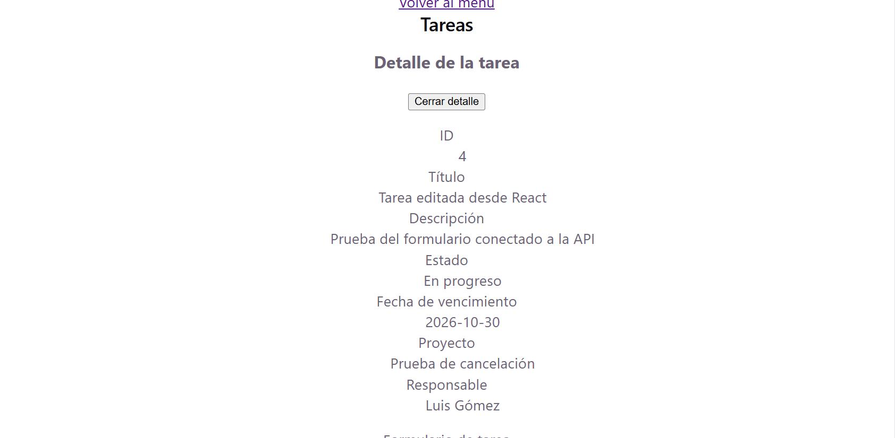
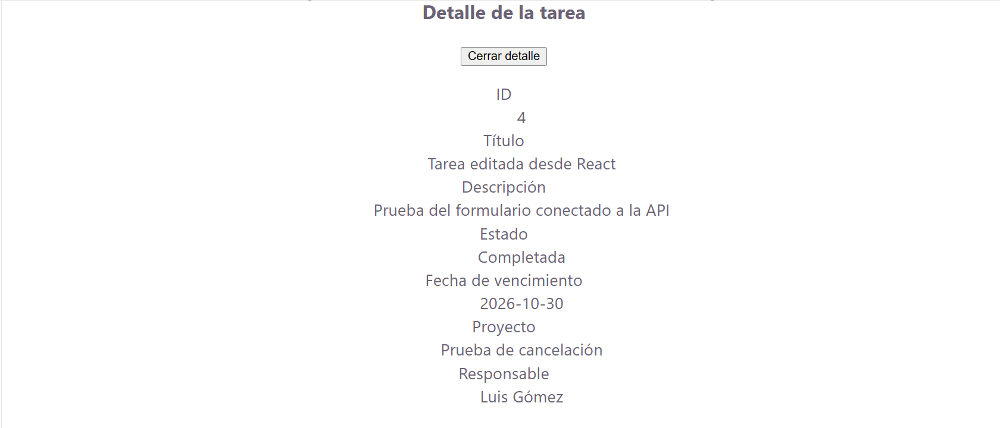
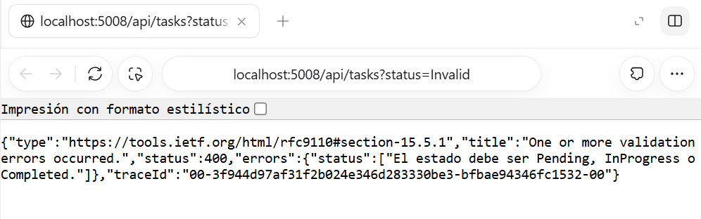
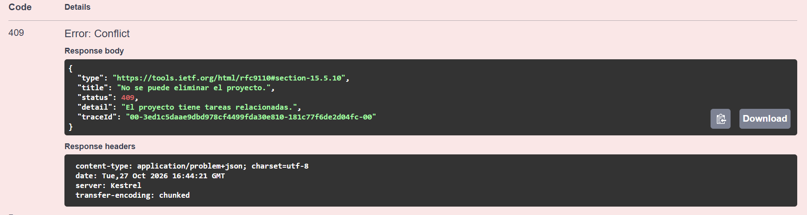
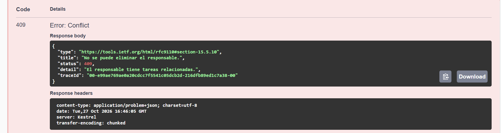
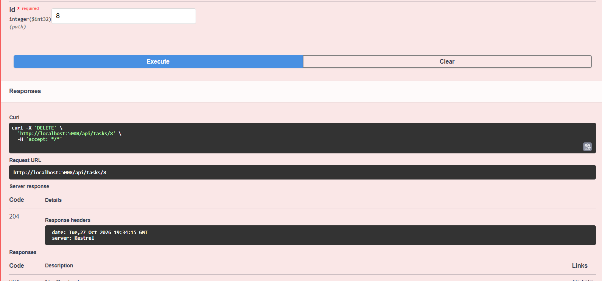

# Pruebas de aceptación

## Forma de registro

Cada caso debe incluir:
- Datos utilizados e identificadores reales.
- Resultado esperado.
- Resultado observado.
- Evidencia: captura o respuesta HTTP.
- Estado: pendiente, parcial o completado.

Las comprobaciones previas se registran como parciales cuando
todavía falta cubrir algún escenario o adjuntar evidencia.

## Seguimiento
| Caso | Comprobaciones realizadas | Pendiente |
|---|---|---|
|| P01 — Proyectos | Completado: creación, listado, detalle, edición y eliminación desde React; creación y actualización verificadas en SQL Server y ausencia del registro comprobada después de eliminar. | Ninguno. |
| P02 — Responsables | CRUD desde API y React comprobado durante el desarrollo. | Reunir evidencias y verificar el caso completo con un responsable temporal sin tareas. |
| P03 — Tareas | Completado: CRUD desde API y React; edición de campos y cambio de proyecto comprobados. Relación y persistencia verificadas en SQL Server. | Ninguno. |
| P04 — Obligatorios y longitudes | Completado: campos obligatorios y espacios rechazados; límites de nombres, título, descripciones y correo comprobados en API y React. Registros temporales eliminados. | Ninguno. |
| P05 — Correo | Completado: duplicado normalizado devuelve 409; edición con correo ajeno devuelve 409; correo propio devuelve 200. Listado comprobado. | Ninguno. |
| P06 — Relaciones | Completado: creación y edición con proyecto y responsable inexistentes devuelven 400 con errores por campo. El POST no agrega registros y el PUT conserva los datos originales. Limpieza temporal con 204. | Ninguno. ||
| P07 — Fechas | Rechazados vencimientos anteriores al inicio y cambios incompatibles del inicio del proyecto. | Completar evidencias y comprobar vencimiento igual al inicio del proyecto. |
| P08 — Borrado | Completado: bloqueo por tareas desde API y React, incluida una única tarea completada; reasignación y eliminación de tareas temporales; borrado posterior de padres sin tareas con 204. | Ninguno. |
| P09 — Estados | Completado: creación en Pending, estado inválido rechazado, tarea completada y reabierta; persistencia comprobada al recargar. | Ninguno. |
| P10 — Filtros | Filtros individuales, combinados, sin coincidencias y limpieza comprobados. | Preparar los datos de demostración y ejecutar el caso exacto solicitado. |
| P11 — Errores | Varios 404 y errores con API detenida comprobados durante el desarrollo. | Completar consulta, edición y borrado inexistentes por recurso; conservación del formulario ante fallo. |
| P02 — Responsables | Completado: creación, listado, detalle, edición y eliminación desde React con un responsable temporal sin tareas; resultados verificados en SQL Server. | Ninguno. |
## Registro detallado

Se agregará una sección por cada prueba ejecutada, indicando
resultado esperado, observado y ubicación de la evidencia.
### P09 — Completar y reabrir una tarea

- Tarea utilizada: ID 4, Tarea editada desde React.
- Resultado esperado: permitir cambiar de Completada a En progreso
  y conservar cada estado después de recargar el navegador.
- Resultado observado: la tarea conservó Completada después de
  recargar y, al reabrirla, conservó En progreso.
- Estado: cambio de estados y persistencia comprobados.
- Estado inválido: rechazo 400 comprobado y evidencia adjunta.
- Estado de P09: completado.
| P09 — Estados | Completado: completar y reabrir la tarea ID 4, comprobar persistencia al recargar y rechazar estado inválido con 400. Evidencias adjuntas en el registro detallado. | Ninguno. |

#### Evidencia de reapertura

#### Evidencia de tarea completada

#### Evidencia de estado inválido

- Solicitud: GET /api/tasks?status=Invalid.
- Resultado esperado: 400 y mensaje de estado no permitido.
- Resultado observado: 400 con el mensaje
  "El estado debe ser Pending, InProgress o Completed.".
- La consulta no modifica datos.

### P08 — Borrado y reasignación

- Proyecto temporal: ID 8.
- Responsable: Responsable temporal P08.
- Tarea temporal: ID 7.
- Resultado esperado: bloquear el borrado mientras existan tareas
  asociadas y permitirlo después de reasignarlas.
- Resultado observado:
  - React mostró el bloqueo al intentar eliminar el proyecto
    y el responsable con la tarea asociada.
  - La tarea ID 7 se reasignó a Prueba de cancelación y Luis Gómez.
  - Después se eliminaron el proyecto y el responsable temporales.
  - La tarea permaneció con sus nuevas relaciones.
  - Finalmente se eliminó la tarea temporal ID 7.
  - Al recargar, permanecieron las tres tareas originales.
- Estado: recorrido de borrado y reasignación comprobado.
- Códigos HTTP: el bloqueo 409 se verificó anteriormente en la API;
  no se capturó el código HTTP de las eliminaciones de esta sesión.
  #### P08 — Bloqueo con una única tarea completada

- Registros utilizados: tarea ID 8, proyecto ID 9 y responsable ID 8.
- La tarea estaba Completada y era la única asociada a ambos.
- DELETE del proyecto 9: 409.
- DELETE del responsable 8: 409.
- Después de eliminar la tarea 8 con respuesta 204:
  - DELETE del proyecto 9: 204.
  - DELETE del responsable 8: 204.
- Al recargar React, los registros temporales desaparecieron
  y permanecieron las tres tareas originales.
- Estado de P08: completado.

### Verificación de instalación y persistencia

Resultado: completada.

- Se descargó una copia del repositorio en una carpeta separada.
- Se restauraron las dependencias del backend y del frontend.
- Se creó la base GestorProyectosDb_Verificacion en SQL Server.
- Se aplicaron correctamente las tres migraciones del proyecto.
- Se comprobó que los listados estaban inicialmente vacíos.
- Se crearon un proyecto, un responsable y una tarea desde React.
- Los registros se conservaron después de recargar el navegador
  y después de detener e iniciar nuevamente la API.
- La compilación del backend y del frontend terminó correctamente.
- El análisis con Oxlint terminó sin advertencias ni errores.

La comprobación se realizó en el mismo equipo, utilizando una copia
separada y una base nueva. La base original no se modificó.
## P01 — CRUD de proyectos

Estado: completado.

Se utilizó el proyecto temporal con ID 10, sin tareas asociadas.

- Se creó desde React y se comprobó su aparición en el listado y detalle.
- Se consultó en GestorProyectosDb y coincidieron sus datos.
- Se actualizaron nombre, descripción y fecha de inicio.
- Los cambios se conservaron al recargar y coincidieron con SQL Server.
- Se eliminó desde React y dejó de aparecer después de recargar.
- La consulta SQL por ID 10 devolvió cero filas tras la eliminación.

### Evidencias

- [Creación y detalle](evidencias/P01-proyecto-creado.png)
- [Creación en SQL Server](evidencias/P01-proyecto-creado-sql.png)
- [Proyecto editado](evidencias/P01-proyecto-editado.png)
- [Edición en SQL Server](evidencias/P01-proyecto-editado-sql.png)
- [Eliminación en React](evidencias/P01-proyecto-eliminado.png)
- [Ausencia en SQL Server](evidencias/P01-proyecto-eliminado-sql.png)
## P02 — CRUD de responsables

Estado: completado.

Se utilizó el responsable temporal con ID 9, sin tareas asignadas.

- Se creó desde React y apareció en el listado y detalle.
- Sus datos coincidieron con la consulta en SQL Server.
- Se actualizaron el nombre y el correo electrónico.
- Los cambios permanecieron después de recargar y coincidieron con SQL Server.
- Se eliminó desde React y dejó de aparecer después de recargar.
- La consulta SQL por ID 9 devolvió cero filas tras la eliminación.

### Evidencias

- [Creación y detalle](evidencias/P02-responsable-creado.png)
- [Creación en SQL Server](evidencias/P02-responsable-creado-sql.png)
- [Responsable editado](evidencias/P02-responsable-editado.png)
- [Edición en SQL Server](evidencias/P02-responsable-editado-sql.png)
- [Eliminación en React](evidencias/P02-responsable-eliminado.png)
- [Ausencia en SQL Server](evidencias/P02-responsable-eliminado-sql.png)
## P03 — Cambio de proyecto de una tarea

Estado: completado, junto con las comprobaciones previas del CRUD de tareas.

Se utilizó la tarea temporal ID 9, asignada a Luis Gómez,
con vencimiento 2026-10-30.

- Se creó en Proyecto origen P03.
- Se verificó su relación inicial en SQL Server.
- Desde React se cambió a Proyecto destino P03.
- Después de recargar, conservó el mismo ID y mostró el proyecto destino.
- SQL Server confirmó el cambio de ProjectId.
- El responsable y el vencimiento se mantuvieron.
- Al finalizar se eliminaron la tarea y ambos proyectos temporales.
- Las consultas de limpieza devolvieron cero filas.

### Evidencias

- [Proyecto de origen en React](evidencias/P03-tarea-proyecto-origen.png)
- [Relación inicial en SQL Server](evidencias/P03-tarea-proyecto-origen-sql.png)
- [Proyecto destino en React](evidencias/P03-tarea-proyecto-destino.png)
- [Relación actualizada en SQL Server](evidencias/P03-tarea-proyecto-destino-sql.png)
- [Limpieza de registros temporales](evidencias/P03-limpieza-sql.png)
## P04 — Campos obligatorios y límites de longitud

Estado: completado.

### Resultados de la API

- Nombres vacíos o compuestos solo por espacios: 400.
- Correo vacío o con formato inválido: 400.
- Título vacío o compuesto solo por espacios: 400.
- Proyecto sin fecha de inicio: 400.
- Tarea sin vencimiento, proyecto o responsable: 400.
- Nombres de proyecto y responsable: 100 caracteres aceptados;
  101 rechazados.
- Título de tarea: 150 caracteres aceptados; 151 rechazados.
- Descripciones de proyecto y tarea: null y 1000 caracteres
  aceptados; 1001 rechazados.
- Correo: 254 caracteres aceptados; 255 rechazados.
- Las nueve pruebas del bloque automático coincidieron con
  los códigos esperados.
- Todos los registros temporales creados durante las pruebas
  fueron eliminados con respuesta 204.

### Resultados de React

- Se comprobaron los mensajes de validación de nombres y título.
- Nombre del proyecto: máximo 100 caracteres.
- Descripción del proyecto: máximo 1000.
- Nombre del responsable: máximo 100.
- Correo del responsable: máximo 254.
- Título de tarea: máximo 150.
- Descripción de tarea: máximo 1000.

Los límites se comprobaron pegando texto superior al máximo y
contando los caracteres aceptados, sin guardar los formularios.

### Evidencia del bloque automático

[Resumen de las nueve pruebas de API](evidencias/P04-validaciones-api-resumen.png)

Las capturas individuales de P04 se conservan en docs/evidencias.
## P06 — Relaciones inválidas

Estado: completado.

- Se comprobó que proyecto y responsable con ID 9999 no existían.
- POST de tarea con ambas relaciones inválidas devolvió 400,
  con errores para ProjectId y AssigneeId.
- El listado conservó los mismos tres IDs después del POST rechazado.
- PUT de una tarea temporal con ambas relaciones inválidas devolvió
  400 con los errores correspondientes.
- Una consulta posterior confirmó que todos los datos originales
  permanecieron sin cambios.
- Las tareas temporales 13 y 14 se eliminaron con respuesta 204.

La primera ejecución tuvo un problema en el script de lectura de
errores de PowerShell. Se corrigió el lector y se verificaron
los mensajes de validación sin modificar el código de la API.

### Evidencia

[Respuestas y resumen de P06](evidencias/P06-relaciones-invalidas-resumen.png)